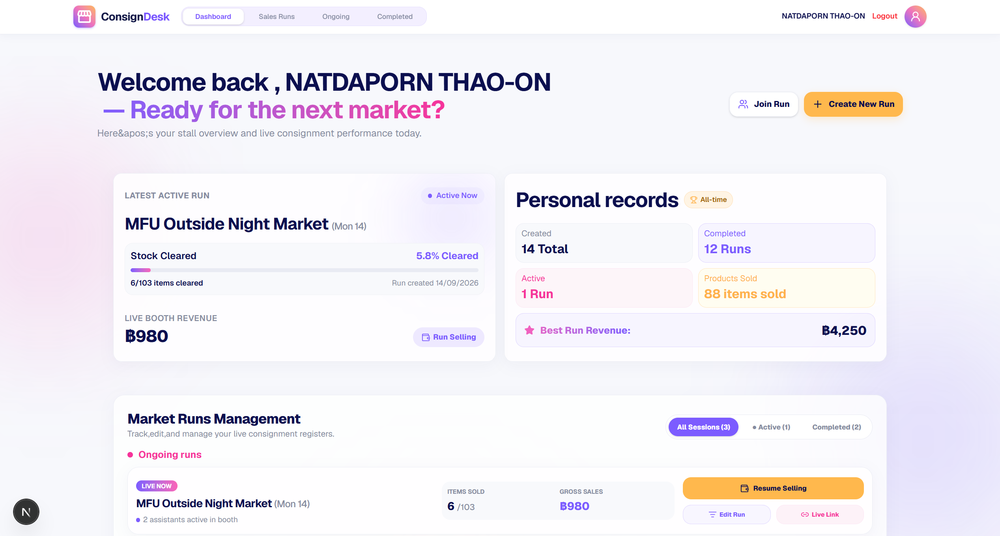
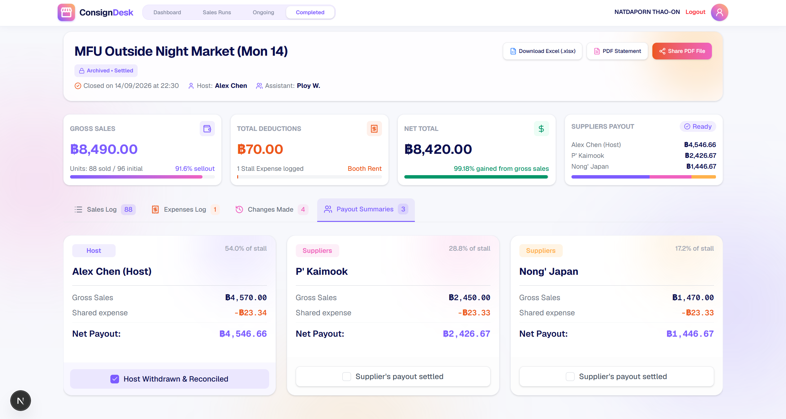

<div align="center">

# 🎨 ConsignDesk

### Building Smarter Solutions Through Technology

A university coursework project developed to solve real-world problems through technology and innovation.

<br/>


<br/>

[Features](#features) •
[Tech Stack](#tech-stack) •
[Screenshots](#screenshots) •
[Installation](#installation) •
[Contributors](#-contributors)

</div>

---

## 📖 About The Project

ConsignDesk is here to rescue shared booth management from the chaos of manual records! 📝❌ It provides a centralized, transparent platform where Host and Assistance can effortlessly manage products, track transactions, and calculate fair revenue sharing and shared expenses for Suppliers.

### 🎯 Project Objectives

📊 Track sales and update inventory in real time.

💰 Calculate each Suppliers's earnings accurately.

🧾 Allocate shared expenses, such as booth rental and transportation costs.

📈 Generate transparent sales and financial summaries.

✅ Reduce manual errors and financial disputes.

### 🎯 Target Users
<details>
<summary><b>1. Host</b> <i>(Click to expand)</i></summary>

*   Create and manage **Sales Runs**.
*   Manage suppliers, products, and inventory.
*   Invite members and assign access permissions.
*   Monitor sales transactions and log expenses.
*   Review sales summaries and export final reports.
</details>

<details>
<summary><b>2. Collaborator / Assistant</b> <i>(Click to expand)</i></summary>

*   Monitor product inventory and sales performance.
*   View individual sales records and earnings.
*   Review financial summaries and allocated expenses.
*   Track live sales progress during an active Sales Run.
</details>

---
<a id="features"></a>
## ✨ Features


| 🗝️ Feature | 📝 Description |
|:---|:---|
| **Authentication** | Secure user login and protected access. |
| **Sales Run & Collab** | Create and manage dedicated sales session rooms with multi-user collaboration for assistants and suppliers. |
| **Real-Time Activity** | Live tracking of sales transactions, automated stock updates, and central expense logging. |
| **Smart Allocation** | Automated gross earnings calculation per supplier with proportional shared booth expense deductions. |
| **Live Dashboard** | Real-time metrics for sales activity and inventory, featuring view-only access links for stakeholders and everyone involved. |
| **Data Export** | Post-run sales summaries and local data exports via CSV, XLSX, and PDF formats. |

---
<a id="tech-stack"></a>
## 🛠️ Tech Stack

Technologies used in this project:

<div align="center">


</div>

---
<a id="screenshots"></a>
## 🖼️ The Gallery (Screenshots)

| 🏠 Homepage | 📊 Dashboard |
|:---:|:---:|
|  |  |
| <br> **⚙️ Main Features** <br> | 
|  | 

---


## 📂 Project Structure

```text
ArtApp/Frontend
│
├── src/
│   ├── components/
│   ├── pages/
│   ├── services/
│   └── assets/
│
├── images/
│   ├── homepage.png
│   ├── dashboard.png
│   └── features.png
│
├── public/
├── package.json
└── README.md
```
```text
ArtApp/Backend
│
├── src/
│   ├── components/
│   ├── pages/
│   ├── services/
│   └── assets/
│
├── images/
│   ├── homepage.png
│   ├── dashboard.png
│   └── features.png
│
├── public/
├── package.json
└── README.md
```
---
<a id="installation"></a>
## ⚙️ Installation

Follow these steps to run the project locally.

### 1. Clone the repository

```bash
git https://github.com/6831503059Piyapat/ArtApp.git
```

### 2. Navigate to the project directory

```bash
cd ArtApp
```

### 4. Run the application

```bash
Run 
```

> Note: Make sure Node.js and npm are installed before running the project.

---

## 👥 Contributors

<div align="center">
<table>
  <tr>
    <td align="center">
      <br />
      <sub><b>Kanyaphorn Saengwong</b></sub><br />
      <code>6831503033</code><br />
      📝 Docs
    </td>
   <td align="center">
      <br />
      <sub><b>Natdaporn Thao-on</b></sub><br />
      <code>6831503043</code><br />
      🗄️ Database / 🎨 Frontend
    </td>
    <td align="center">
      <br />
      <sub><b>Piyapat Koedsuk</b></sub><br />
      <code>6831503059</code><br />
      ⚙️ Backend / 🎨 Frontend
    </td>
    <td align="center">
      <br />
      <sub><b>Sirinan Mahapibule</b></sub><br />
      <code>6831503074</code><br />
      📝 Docs / 🎨 Frontend
    </td>
    <td align="center">
      <br />
      <sub><b>Sutheemon Kawee</b></sub><br />
      <code>6831503077</code><br />
      📝 Docs
    </td>
  </tr>
</table>
</div>

---

## 📚 Academic Information

- **Course:** [Web Application/ Database/ SRAS]
- **University:** Mae Fah Luang University
- **Semester:** [1/2026]
- **Academic Year:** 2026

---

## 🙏 Acknowledgements

We would like to thank our instructor and everyone who supported us throughout this project.

---

<div align="center">

### 💙 Thank you for visiting our project!

**Developed with suffering by our team.**

⭐ If you find this project interesting, consider giving it a star!

</div>
