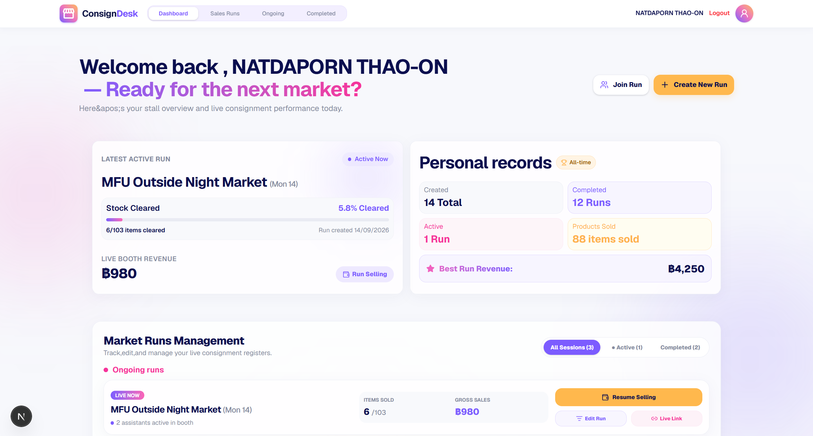
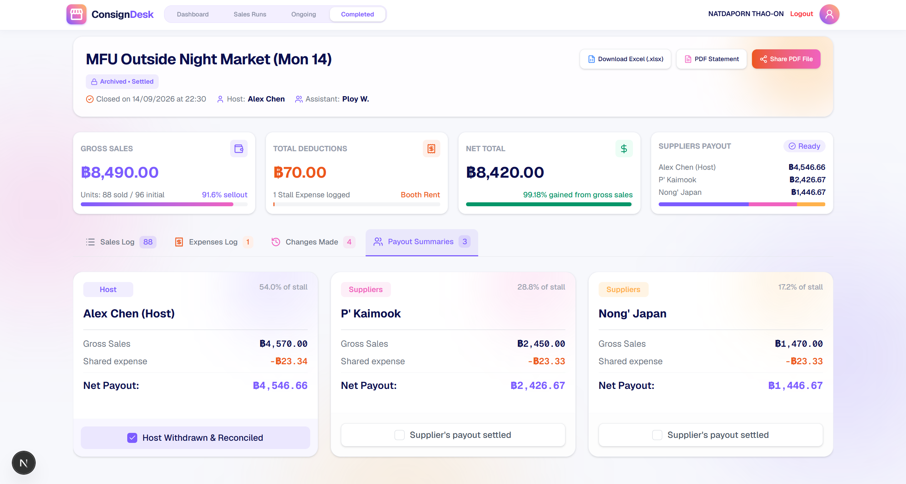

<div align="center">

# 🚀 ConsignDesk

### Building Smarter Solutions Through Technology

A university coursework project developed to solve real-world problems through technology and innovation.

<br/>


<br/>

[Features](#-features) •
[Tech Stack](#-tech-stack) •
[Screenshots](#-screenshots) •
[Installation](#-installation) •
[Contributors](#-contributors)

</div>

---

## 📖 About The Project

ConsignDesk is a web application for managing artist merchandise consignment, tracking sales and inventory, and calculating revenue sharing and shared expenses.

The system is designed to improve accuracy, transparency, and operational efficiency in shared booth management.

Instead of relying on manual records and calculations, ConsignDesk provides a centralized platform where booth administrators and artists can manage products, monitor transactions, and review financial information.

### 🎯 Project Objectives

📊 Track sales and update inventory in real time.

💰 Calculate each Suppliers's earnings accurately.

🧾 Allocate shared expenses, such as booth rental and transportation costs.

📈 Generate transparent sales and financial summaries.

✅ Reduce manual errors and financial disputes.

### 🎯 Target Users
1. Booth Administrator / Host:

#Responsibilities:
>> Create and manage Sales Runs.
>> Manage suppliers, products, and inventory and.
>> Invite members and manage access permissions.
>> Monitor sales transactions and expenses.
>> Review sales summaries and export reports.

2. Collaborator/Assistance
#Responsibilities:

>> Monitor product inventory and sales performance.
>> View individual sales records and earnings.
>> Review financial summaries and allocated expenses.
>> Track sales progress during an active Sales Run.


---

## ✨ Features

| Feature | Description |
|---|---|
| 🔐 Authentication | Secure user login and access |

| 📅 Sales Run Management  & Collaboration| Creating, configuring, and managing dedicated sales session rooms ("Sales Runs") with multi-user collaboration support to invite staff (assistants) and participating consignors (suppliers). |

| 📦 Real-Time Stock & Sales Activity | Real-time tracking of sales transactions, automated stock level updates, central expense logging and edits made to the run |

| 💰 Automated Revenue & Expense Allocation| Automated calculation of gross earnings per supplier, proportional deduction of shared booth expenses|

| 📊  Live Statistics Dashboard | Real-time metrics dashboard displaying current sales activity and remaining inventory, with shareable view-only access links for stakeholders and everyone involved. 
 |

 | 📈 Sales Summary & Data Export| Post-run sales summary pages and local data export functionalities supporting CSV, XLSX, and PDF formats. |


---

## 🛠️ Tech Stack

Technologies used in this project:

<div align="center">


</div>

---

## 📸 Screenshots

### 🏠 Homepage
!

### 📊 Dashboard
!

### ⚙️ Main Features
!

---

## 📂 Project Structure

```text
ArtApp/Frontend
│
├── src/
│   ├── components/
│   ├── pages/
│   ├── services/
│   └── assets/
│
├── images/
│   ├── homepage.png
│   ├── dashboard.png
│   └── features.png
│
├── public/
├── package.json
└── README.md
```
```text
ArtApp/Backend
│
├── src/
│   ├── components/
│   ├── pages/
│   ├── services/
│   └── assets/
│
├── images/
│   ├── homepage.png
│   ├── dashboard.png
│   └── features.png
│
├── public/
├── package.json
└── README.md
```
---

## ⚙️ Installation

Follow these steps to run the project locally.

### 1. Clone the repository

```bash
git https://github.com/6831503059Piyapat/ArtApp.git
```

### 2. Navigate to the project directory

```bash
cd ArtApp
```

### 4. Run the application

```bash
Run 
```

> Note: Make sure Node.js and npm are installed before running the project.

---

## 👥 Contributors

|---|---|---|
| Kanyaphorn Saengwong | 6831503033
 | Documentation |
| Natdaporn Thao-on | 6831503043 | Database/ frontend |
| Piyapat Koedsuk | 6831503059 | Backend /frontend|
| Sirinan Mahapibule | 6831503074 | Documentation/ frontend|
| Sutheemon Kawee | 6831503077 | Documentation |

---

## 📚 Academic Information

- **Course:** [Web Application/ Database/ SRAS]
- **University:** Mae Fah Luang University
- **Semester:** [1/2026]
- **Academic Year:** 2026

---

## 🙏 Acknowledgements

We would like to thank our instructor and everyone who supported us throughout this project.

---

<div align="center">

### 💙 Thank you for visiting our project!

**Developed with suffering by our team.**

⭐ If you find this project interesting, consider giving it a star!

</div>
